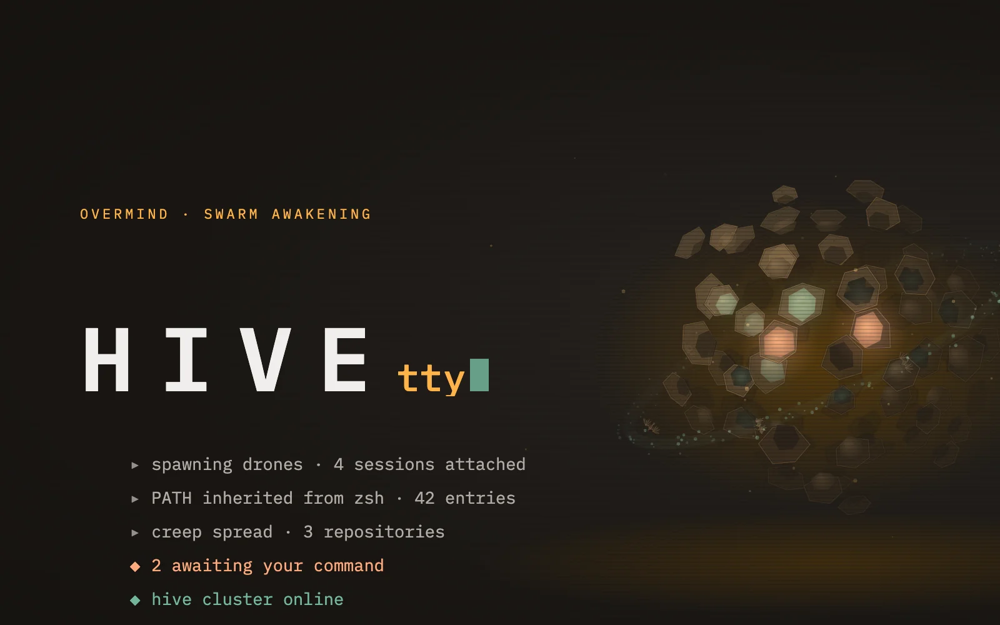
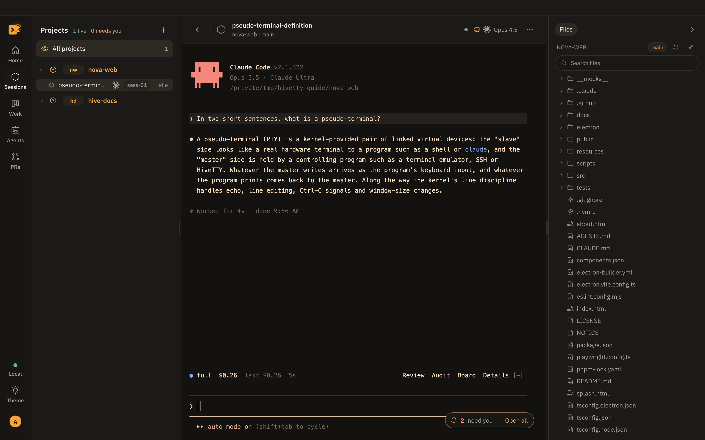

# HiveTTY Pro

**A hive mind for your sessions: many workers, one queen, nothing slipping through the comb.**

HiveTTY Pro is a command center for many agentic coding sessions on one Mac. Every session is
a real CLI in a real terminal, unchanged: **Claude Code**, **OpenAI Codex** or **GitHub Copilot
CLI**, with the same keys, the same output and the same conversation. Around them sits
everything you would otherwise leave the terminal for: an inbox that surfaces the session
waiting on you, Jira tickets, pull requests, a file explorer and editor, custom skills, and
background agents.



## Contents

**On this page**

- [What it does](#what-it-does)
- [Quick start](#quick-start)
- [Plans](#plans)
- [Requirements](#requirements)
- [How it fits together](#how-it-fits-together)
- [Documentation](#documentation)
- [Development](#development)
- [Stack](#stack)
- [Licence](#licence)

**Guides** (using HiveTTY Pro)

| Start here | Everyday work | Automation | Setup and reference |
| --- | --- | --- | --- |
| [Getting started](docs/guide/getting-started.md) | [Sessions and terminals](docs/guide/sessions.md) | [Agents](docs/guide/agents.md) | [Settings](docs/guide/settings.md) |
| [A tour of the window](docs/guide/tour.md) | [The overmind console](docs/guide/overmind-console.md) | [The ledger](docs/guide/ledger.md) | [The config file](docs/guide/configuration.md) |
| [Troubleshooting](docs/guide/troubleshooting.md) | [The inbox](docs/guide/inbox.md) | [Slack](docs/guide/slack.md) | [Themes](docs/guide/themes.md) |
| | [Jira and pull requests](docs/guide/work-and-prs.md) | [Containers](docs/guide/containers.md) | [Updates](docs/guide/updates.md) |
| | [Files and the editor](docs/guide/explorer.md) | [Server mode and remote attach](docs/guide/remote.md) | |
| | [Custom skills](docs/guide/skills.md) | [The workflow](docs/guide/workflow.md) | |

**Internals** (working on HiveTTY Pro): [architecture](docs/architecture.md) ·
[harnesses](docs/harness-architecture.md) · [development](docs/contributing.md) ·
[every deep dive](docs/README.md#internals)

## What it does

| Feature | What it does |
| --- | --- |
| **Runs the terminals** | One real PTY per session, on the CLI you pick: Claude Code, Codex or Copilot. Start one from a project, a Jira ticket, or the console: `spawn hivetty "fix the lead form"`. [Sessions](docs/guide/sessions.md) |
| **Notices when one needs you** | Each CLI's hooks report in, so a permission prompt or a finished turn raises an inbox card instead of scrolling past in a tab you were not watching. [Inbox](docs/guide/inbox.md) |
| **Keeps the work in view** | Jira tickets and `gh` pull requests, matched to the session that made them. [Jira and PRs](docs/guide/work-and-prs.md) |
| **Opens the repository** | A project explorer over the active session's checkout, opening files into a CodeMirror editor. [Files](docs/guide/explorer.md) |
| **Carries your skills** | Skill folders under `~/.hivetty/skills` reach every session HiveTTY Pro starts, on every CLI, and no other. [Skills](docs/guide/skills.md) |
| **Runs agents in the background** | Headless runs on the CLI and model each agent names, that wake on a schedule, a message or a Slack mention, and ask you before they act. [Agents](docs/guide/agents.md) |
| **Serves from another Mac** | Run sessions on one always-on Mac and drive them from another over Tailscale. [Remote](docs/guide/remote.md) |
| **Follows a theme all the way down** | Chrome, terminal and editor all take their colours from one theme file. [Themes](docs/guide/themes.md) |
| **Ends cleanly** | `/done` finishes a session and closes its terminal. The row stays readable, with Resume. [Sessions](docs/guide/sessions.md#finish-with-done) |

## Quick start

1. Download the `.dmg` from [the latest release](https://github.com/behiques/hivetty/releases/latest)
   (macOS, Apple silicon). It updates itself.
2. Open it and **sign in** in your browser. A new account starts a 14-day free trial, no card
   needed, or choose a plan.
3. Click **Add a project** on Home, and choose a repository folder.
4. Click **New session**, pick a CLI, type the project's name, and press Enter.

That is a live session. The full walkthrough is in [Getting started](docs/guide/getting-started.md).

## Plans

HiveTTY Pro needs an account with a plan or a trial. The trial is the Team plan.

| | Solo | Team | Enterprise |
| --- | --- | --- | --- |
| Claude Code sessions and agents | ✓ | ✓ | ✓ |
| Codex | ✓ | ✓ | ✓ |
| Copilot | | ✓ | ✓ |
| Shared team ledger | | ✓ | ✓ |

A feature your plan does not include is shown locked, with an **Upgrade** button, never hidden.
Your plan, seats, devices and invoices are in **Settings › Account centre**
([Settings](docs/guide/settings.md#account-centre)).

## Requirements

| Need | Why | Without it |
| --- | --- | --- |
| **A HiveTTY account** | the licence | the window stays on the sign-in screen |
| **At least one agent CLI** on your `PATH`: `claude`, `codex` or `copilot`, signed in | every session is a real CLI | that CLI is dimmed in the picker, with the line that installs it |
| **git** | the branch each session is on | branches read as a dash |
| **[`gh`](https://cli.github.com)**, signed in | the PRs tab | the PRs tab stays empty |
| **A Jira account** (optional) | the Work tab | the tab says how to connect |

macOS on Apple silicon. Linux and Windows have no release build.

## How it fits together

<picture>
  <source media="(prefers-color-scheme: dark)" srcset="docs/assets/diagrams/overview.dark.svg">
  
</picture>

Sessions report their state back through each CLI's own hooks. That is how the inbox knows
which one needs you. Every CLI plugs in through one harness port, so the rest of the app never
asks which one it is talking to. The long version is in [Architecture](docs/architecture.md)
and [Harness architecture](docs/harness-architecture.md).

## Documentation

Everything lives in [`docs/`](docs/README.md), in two layers:

- **[Guides](docs/README.md#guides)**: short, task-first pages with screenshots and examples.
- **[Internals](docs/README.md#internals)**: the deep dives on how each part is built, for the
  team working on it.

## Development

This repository is private. To work on it:

```sh
pnpm install
pnpm desktop:dev     # the Electron app with hot reload
pnpm lint && pnpm type-check && pnpm test
```

Node 22 ([`.nvmrc`](.nvmrc)) and pnpm (pinned in `package.json`). `pnpm lint` and
`pnpm type-check` must both pass before any change is done. The commands, the test layers and
the architecture rules are in [Development](docs/contributing.md) and [`AGENTS.md`](AGENTS.md).

## Stack

React 19 · TypeScript (strict) · Vite · Electron · xterm.js · CodeMirror 6 · Zustand ·
Tailwind v4 · shadcn/ui · pnpm

## Licence

Proprietary. Copyright © 2026 Behiques Consulting LLC. All rights reserved. See [LICENSE](LICENSE);
use of a released build is governed by the End User Licence Agreement ([EULA.md](EULA.md), in draft).
Open-source components and their licences are listed in [NOTICE](NOTICE).
