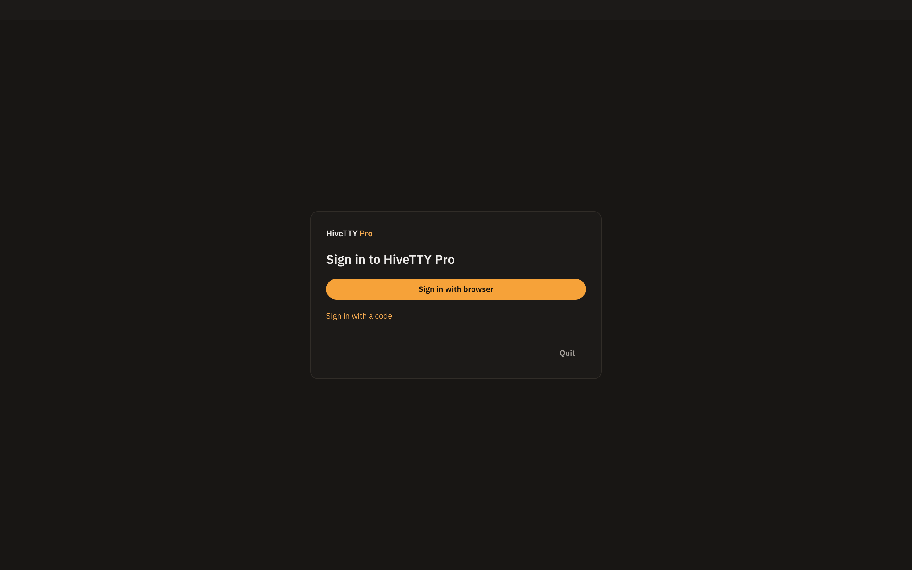
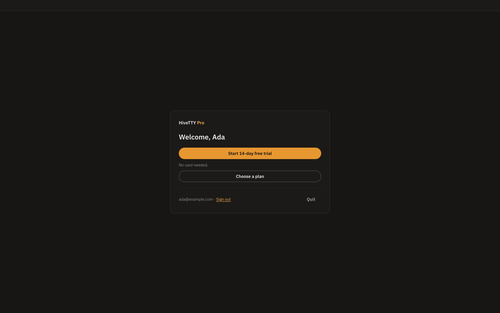
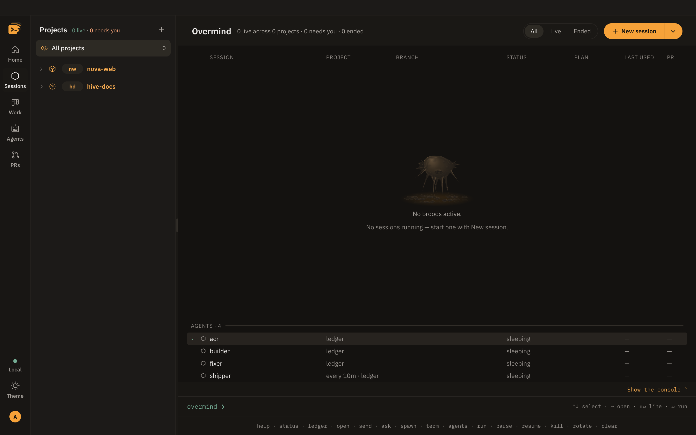
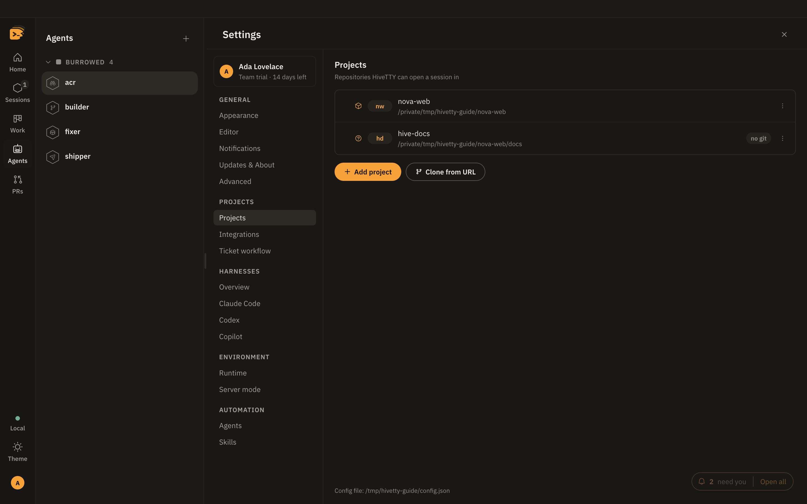
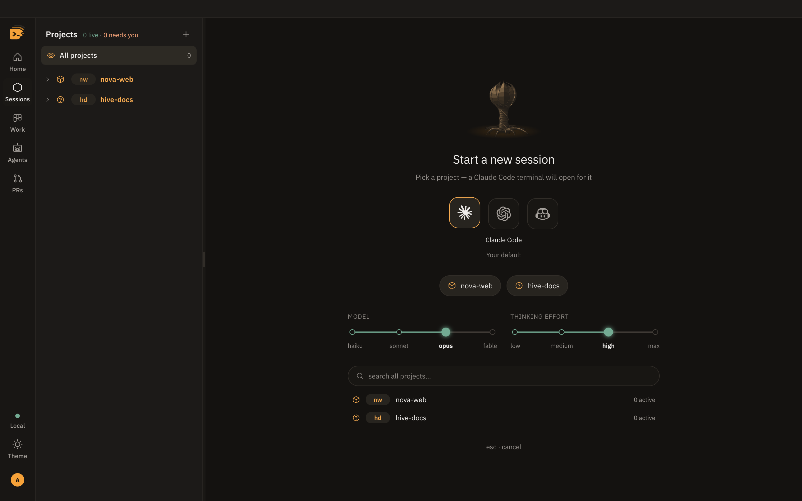

# Getting started

From download to a live agent session, on Claude Code, Codex or Copilot, in about two minutes.

**On this page:** [Install](#install) · [Requirements](#requirements) ·
[Sign in](#sign-in) · [First launch](#first-launch) · [Map your first project](#map-your-first-project) ·
[Start your first session](#start-your-first-session) · [Run from source](#run-from-source) ·
[Next steps](#next-steps)

## Install

1. Download the `.dmg` from
   [the latest release](https://github.com/behiques/hivetty/releases/latest).
   It is built for macOS on Apple silicon.
2. Drag **HiveTTY Pro** into Applications and open it.
3. That is all. The app checks for updates on its own ([Updates](updates.md)).

If macOS says the app "is damaged", see
[Troubleshooting](troubleshooting.md#hivetty-is-damaged).

## Requirements

| Need | Check it with | Why |
| --- | --- | --- |
| A HiveTTY account | [Sign in](#sign-in) | the licence; a new account starts a 14-day trial |
| At least one agent CLI, signed in | `claude --version`, `codex --version` or `copilot --version` | every session is a real CLI |
| git | `git --version` | shows the branch each session is on |
| GitHub CLI, signed in | `gh auth status` | fills the PRs tab |
| A Jira account | optional | fills the Work tab |

Each CLI's own install line, shown in Settings › Harnesses › Overview when it is missing:

| CLI | Install | Sign in | Plan |
| --- | --- | --- | --- |
| Claude Code | `npm i -g @anthropic-ai/claude-code` | `claude auth login` | every plan |
| Codex | `brew install codex` | `codex login` | Solo and above |
| Copilot | `npm i -g @github/copilot` | `gh auth login` | Team and above |

HiveTTY reads your login shell's `PATH` at startup, so a CLI or `gh` installed with
Homebrew is found even when you open the app from Finder.

## Sign in

The first window is **Sign in to HiveTTY Pro**. Click **Sign in with browser** and finish in your
browser; the app comes back on its own. On a Mac without a browser at hand, **Sign in with a code** shows a
short code to enter on any other device.



A new account has no plan yet, so the next card offers **Start 14-day free trial** (no card
needed, the Team plan) or **Choose a plan**, which opens the plan page in your browser.



The licence renews itself while you are online and keeps working offline until the date shown
in **Settings › Account center › Plan & billing** ([Account center](settings.md#account-center)).

## First launch

The window opens on **Home**. With no project mapped yet, Home is the first-run page: **Add a
project**, connect your integrations, and **New session**. Click **Sessions** on the bar for the
**Overmind**: the fleet table on the stage and your projects in the list panel beside it. It is
empty until you start a session.



On first launch HiveTTY writes `~/.hivetty/config.json` from a commented template. You never
have to open it; Settings edits it for you. See [The config file](configuration.md).

## Map your first project

A **project** is a folder HiveTTY can start sessions in, usually a git repository.

1. Click **Add a project** on Home, or the **+** in the Sessions panel head.
2. Choose the repository folder.
3. The project appears in the Sessions panel with a short **key** (two to four letters, like `hive`).
   You can type the key anywhere a project is asked for.

You can also add, rename, re-key or clone projects in **Settings › Projects**.



## Start your first session

1. Click **New session** on the Overmind (or on Home's first-run page, or the **+** beside
   **Projects** in the Sessions panel).
2. Type part of the project name and press **Enter**.
3. Pick the CLI in the dock under the title: Claude Code, Codex or Copilot. The line under it
   says where the choice came from (your last pick, the project's default, or the global one).
   A CLI that is missing, turned off or not in your plan is dimmed, with the reason.
4. Pick a model and effort first if you want. Claude Code defaults to `opus` and `high`.



A terminal opens on the stage with that CLI running in your project. Type to it
exactly as you would in any terminal.

**Example.** The same thing from the overmind console, in one line (the console always starts
Claude Code):

```text
overmind ❯ spawn hive fix the flaky login test
```

When you are done, type `/done` in the session. The terminal closes and the row stays under
**ENDED**, ready to resume ([Sessions](sessions.md#finish-with-done)).

## Run from source

For the team working on HiveTTY Pro (the repository is private). Linux has no release build,
so run it from source there. The same works on macOS.

```sh
git clone https://github.com/behiques/hivetty.git
cd hivetty
pnpm install
pnpm desktop:dev
```

You need Node 22 (`.nvmrc`) and pnpm. `node-pty` is a native addon: `pnpm install` handles it,
but keep a compiler around in case no prebuild matches your platform.

| Platform | Needs |
| --- | --- |
| macOS | Xcode Command Line Tools (`xcode-select --install`) |
| Linux | `build-essential` and `python3` |
| Windows | Not supported |

## Next steps

- [A tour of the window](tour.md): what every part of the screen does.
- [Sessions and terminals](sessions.md): statuses, names, `/done` and Resume.
- [The inbox](inbox.md): how HiveTTY tells you a session needs you.
