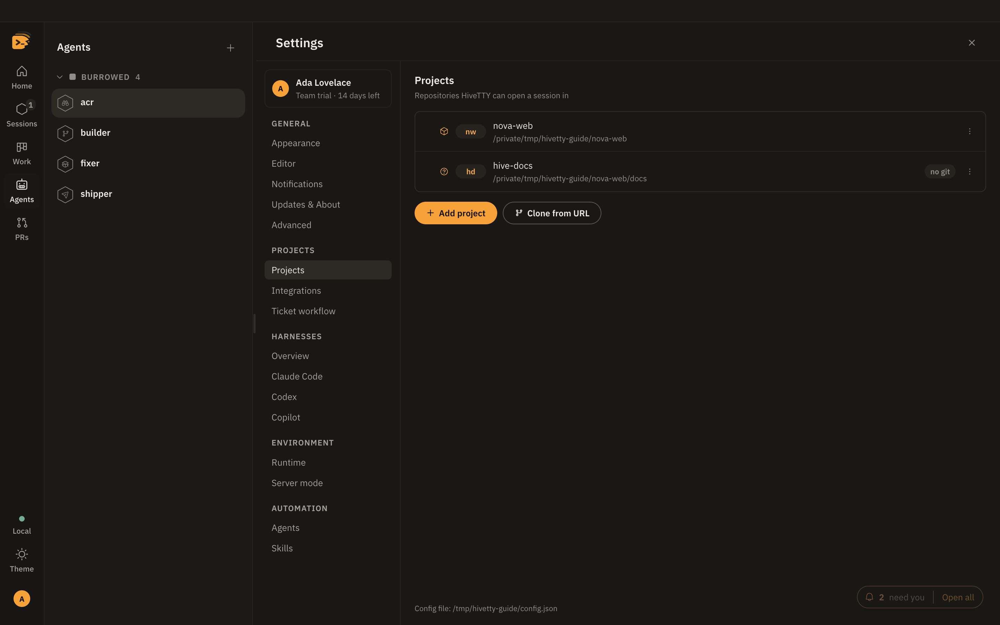
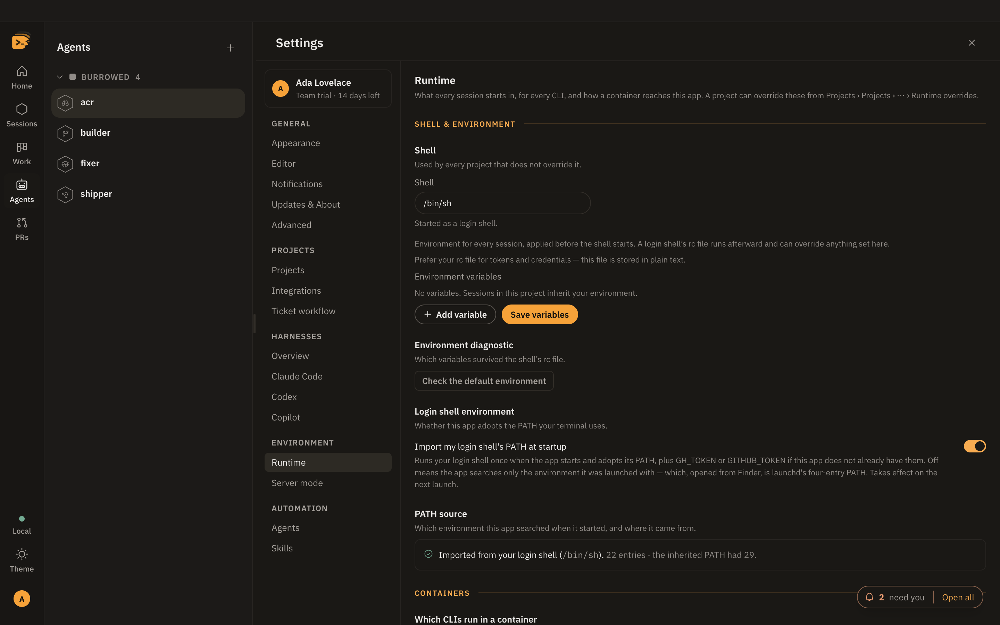
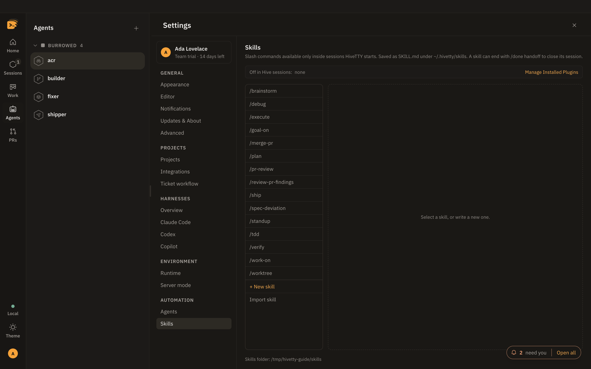
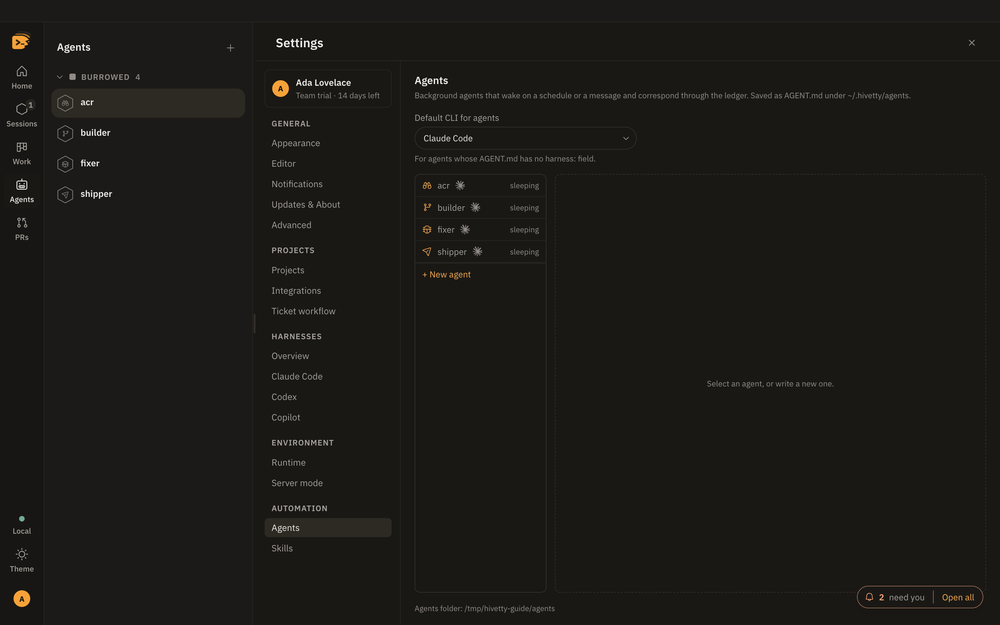
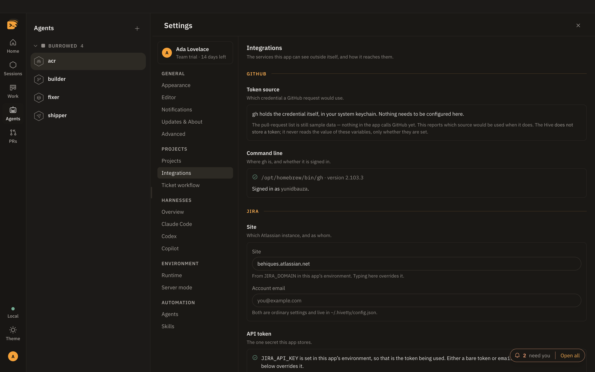

# Settings

Open Settings from your avatar at the foot of the bar (**Settings…**), or press `⌘,`. It opens on the
pane you last had open. When no one is signed in, a gear sits where the avatar would be. Its panes sit in six groups:

| Group | Panes |
| --- | --- |
| General | Appearance, Editor, Notifications, Updates & About, Advanced |
| Projects | Projects, Integrations, Ticket workflow |
| Harnesses | Overview, Claude Code, Codex, Copilot |
| Environment | Runtime (with Containers inside it), Server mode |
| Automation | Agents, Skills |
| Account | Account & devices, Plan & licence, Organisation |

Almost everything here is written to `~/.hivetty/config.json`
([The config file](configuration.md)); appearance and editor preferences stay on this machine.

**On this page:** [Appearance](#appearance) · [Editor](#editor) · [Notifications](#notifications) ·
[Updates & About](#updates--about) · [Advanced](#advanced) · [Projects](#projects) · [Integrations](#integrations) ·
[Ticket workflow](#ticket-workflow) · [Overview](#overview) · [Runtime](#runtime) · [Containers](#containers) ·
[Server mode](#server-mode) · [Agents](#agents) · [Skills](#skills) · [Account & devices](#account--devices) ·
[Plan & licence](#plan--licence)

| Where it is stored | What |
| --- | --- |
| `~/.hivetty/config.json` | projects, runtime, Jira site and email, notifications, Slack, server and remote |
| Encrypted with the Keychain, in the app's data folder | the Jira API token, the Slack tokens, the remote device token |
| `~/.hivetty/skills/`, `~/.hivetty/agents/` | skills and agents |
| This machine only | appearance and editor preferences |

## Projects

Add a folder, **Clone from URL**, rename, re-point, reorder, remove, and edit each project's
two-to-four letter key. When cloning, the URL field lists your GitHub repositories (the ten
most recently pushed, filtered as you type, through `gh`); pick one, or paste any git URL.



**Runtime overrides…** in a project's ⋯ menu changes the shell, the agent command, the
environment and the container for that one project, and checks where its command is found.
Blank inherits [Runtime](#runtime).

**Example.** Point one project at a wrapper script:

```json
{ "id": "nova-web", "path": "~/repos/nova-web", "claudeCommand": "~/bin/claude-nova" }
```

**Default CLI** in a project's ⋯ menu picks the CLI that project's new sessions start with: Claude Code, Codex,
Copilot, or **Use the global default**. A project that names one shows its logo in the list. In the new-session
picker, a CLI you picked this run still wins. Otherwise each project starts on its own default, and the line under
the CLIs says where the choice came from. If the project's CLI is missing or turned off, the picker says so and
starts on the next one.

**Example.** Start one project's sessions on Codex:

```json
{ "id": "hivetty-cloud", "path": "~/repos/hivetty-cloud", "harness": "codex" }
```

## Overview

Settings › Harnesses › Overview lists Claude Code, Codex and Copilot. Each row shows the binary HiveTTY found on
this Mac, or on the server you are attached to, and its version. A CLI that is not there shows why, with the line
that installs it. **Rescan** looks again after you install one. **Use for sessions** takes a CLI out of the new-session
picker, though at least one stays on. **Default** is the CLI a new session starts with, unless its project names its own ([Projects](#projects)); the picker remembers what you
last picked until the app restarts. A CLI that is missing or turned off shows dimmed in the picker, with the reason.
A Claude command that needs a shell to read, such as `$HOME/bin/claude` or `env FOO=1 claude`, can't be checked: the
row says so and Claude Code stays in the picker.

**Example.** Start new sessions on Codex, and keep Copilot out of the picker:

```json
"sessionsDefaultCli": "codex",
"clis": { "copilot": { "sessions": false } }
```

### Headless agents

How each agent CLI runs [agents](agents.md). Claude Code's **Headless agents** group has
**Enabled for agents**, and a default **Model** and **Effort** for agent runs. An agent's own
`model:` or `effort:` in its `AGENT.md` wins; **CLI default** leaves the flag off so the CLI
picks. Turn a CLI off and agents skip it; with no other CLI enabled, they refuse to run and
their row says why.

**Example.** Run agents on Haiku unless they ask for something else:

```json
"clis": { "claude-code": { "agents": { "enabled": true, "model": "haiku" } } }
```

### Codex's own skill list

HiveTTY's skills already reach every Codex session HiveTTY starts. Settings › Harnesses › Codex has
**Install HiveTTY's skills into Codex**, off by default. Turn it on and HiveTTY installs them as a Codex
plugin, `hive@hivetty`, using Codex's own `codex plugin` commands, so they also appear in Codex's `/skills`
list and `$` completion, named like `hive:hive-work-on`. Codex writes the plugin into `~/.codex` on this Mac,
or on the server you are attached to, and `codex plugin list` shows it. HiveTTY keeps it current as your
skills change. The plugin also loads when you run Codex outside HiveTTY; there each skill only says it needs a
HiveTTY session. Turn the setting off and HiveTTY removes the plugin. If a Codex command fails, the row shows
the command and Codex's own message, and the next session start tries again.

**Example.**

```json
"clis": { "codex": { "installSkills": true } }
```

## Runtime

Under **Environment**, in two bands: **Shell & environment**, then **Containers**.

What every session starts in, for every CLI. **Shell** (started as a login shell) and environment variables for
every project. **Import my login shell's PATH at startup** lets a Finder-launched app find Homebrew tools, and the
environment diagnostic shows which variables your rc file overrode. The agent command is on each CLI's page.



### Containers

The second band of Runtime. Which CLIs can run in a project's container (Claude Code today), which of your projects do, and the **Host alias**
and **Bind address** a container uses to reach HiveTTY. A container profile belongs to its project.

## Skills

Create, import and edit [custom skills](skills.md).



## Agents

Create and edit [agents](agents.md) with a form or as source. Each row shows the marks of the CLIs it runs on:
its `harness:` list in order, or the default CLI for agents at the top of the pane.



## Ticket workflow

What a session started from a Jira ticket does first: just open, run a skill, or hand the ticket to an agent.
See [The ticket workflow](work-and-prs.md#the-ticket-workflow).

## Appearance

Mode (System, Dark or Light; the bar's sun or moon flips it too), [themes](themes.md), terminal font, size and scrollback, team name
(shown at the right of Home's headline), density.

## Editor

Placement (Full stage or Split), split direction, Tabs or One at a time, **Markdown** (opens
in Preview or Source), **Allow editing**, font, size, tab width, wrapping, line numbers. See [Files and the editor](explorer.md).

## Integrations

GitHub (which token `gh` would use, and where `gh` is), Jira (site, email, API token, JQL
override) and Slack (sign-in, Socket Mode). See [Jira and pull requests](work-and-prs.md)
and [Slack](slack.md).



## Notifications

One row per event: Off, Inbox or Both. See [The inbox](inbox.md#choosing-what-reaches-you).

## Server mode

Under **Environment**. **Serve this machine**, paired devices, and **Attach to a server**
([Remote](remote.md)). While this window is attached, the bind fields and the device roster are
the server's, and the pane says so.

## Account & devices

Under **Account**. Your name, email and plan, with **Sign out**, and this account's devices, this Mac first.
**Manage devices** opens your account's devices page in the browser, already signed in; revoking a device happens
there. Signed out, the pane says **Sign in to see your account.**

## Plan & licence

Under **Account**. Your plan (with **Trial · N days left** during a trial), devices per seat, runners, and
until when this Mac's licence works offline. **Refresh licence** renews it now; **Manage plan** opens your
account's plan page in the browser, already signed in. Signed out, the pane says **Sign in to see your plan.**

A feature your plan doesn't include is shown locked, with the reason and an **Upgrade** button, never hidden.

## Updates & About

Under **General**. **About** (the HiveTTY, Electron, Chromium and Node versions, and the
platform), **Updates › Check now** with where updates come from, and **What's new**
([Updates](updates.md)).

## Advanced

- **Config file**: its path, **Reveal in Finder**, **Reload**. The file is not watched: edit
  it by hand, then Reload. Reload also picks up skills and agents edited under `~/.hivetty`, so
  the next session and agent run use them. A running session keeps what it started with, and
  the few fields read only at launch (receiver bind, server mode and bind, login environment,
  remote attach) are named under the button as needing a restart.
- **Reset to template**, **Diagnostics**.
