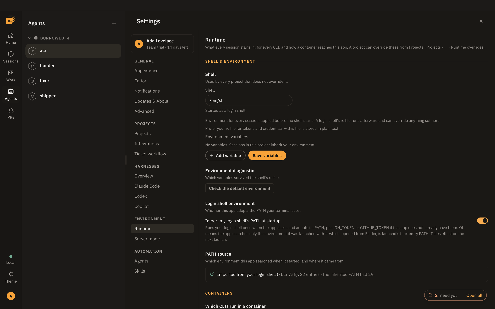

# Troubleshooting

The problems people hit first, and the fix for each.

**On this page:** [A CLI is not found](#a-cli-is-not-found) ·
[posix_spawnp failed](#posix_spawnp-failed) · [HiveTTY is damaged](#hivetty-is-damaged) ·
[The PRs tab is empty](#the-prs-tab-is-empty) · [The Work tab is empty](#the-work-tab-is-empty) ·
[A session is stuck on needs input](#a-session-is-stuck-on-needs-input) ·
[A theme will not import](#a-theme-will-not-import) · [Still stuck](#still-stuck)

## A CLI is not found

Opened from Finder, a Mac app gets a short `PATH` that misses Homebrew and `~/.local/bin`.
**Settings › Harnesses › Overview** shows which of `claude`, `codex` and `copilot` were found,
and the install line for each one that was not; **Rescan** looks again.

1. **Settings › Runtime › Import my login shell's PATH at startup** should be on (it is by
   default). Restart the app after turning it on.
2. Open **Settings › Harnesses › Claude Code**. Its command check shows the `PATH` searched and
   where `claude` was, or was not, found.
3. Or set its **Agent command** to the full path, like `/opt/homebrew/bin/claude`. Codex and
   Copilot take a command of their own on their pages, Settings › Harnesses › Codex and
   Copilot.

A CLI that is found but signed out says so, with its sign-in command: `claude auth login`,
`codex login`, or `gh auth login` for Copilot.



## posix_spawnp failed

`Error: posix_spawnp failed.` on the first session, in a build from source. `node-pty`'s
helper lost its executable bit. Fix it:

```sh
pnpm check:abi --fix
```

`pnpm install` normally repairs this on its own.

## HiveTTY is damaged

macOS says this about a build without a notarized signature. Remove the quarantine flag:

```sh
xattr -dr com.apple.quarantine "/Applications/HiveTTY Pro.app"
```

For a signed but not notarized build, right-click the app and choose **Open** once.

## The PRs tab is empty

```sh
gh auth status
```

If that fails, run `gh auth login`. **Settings › Integrations › Command line** shows which
`gh` the app found and who it is signed in as.

## The Work tab is empty

Check **Settings › Integrations › Jira**: site is a bare hostname, email matches the token,
and **Test connection** passes. A JQL override replaces the default query entirely, so an
override that matches nothing shows nothing.

## A session is stuck on needs input

The card clears when the CLI reports the prompt answered. Pressing Escape on a permission
prompt sends no report, so the status stays until the next prompt. Type anything into the
session to move it on. Codex in a repository with its own `.codex` folder reports nothing at
all until you trust HiveTTY's hooks there.

## A theme will not import

The error names the exact key, like `modes.dark.terminal.bg`. The usual cause is
`terminal.bg` differing from `ui.termBg`: make them match, or drop one. Start from
**Download template** to get every key.

## Still stuck

[Open an issue](https://github.com/behiques/hivetty/issues) with the version from
**Settings › Updates & About**.
